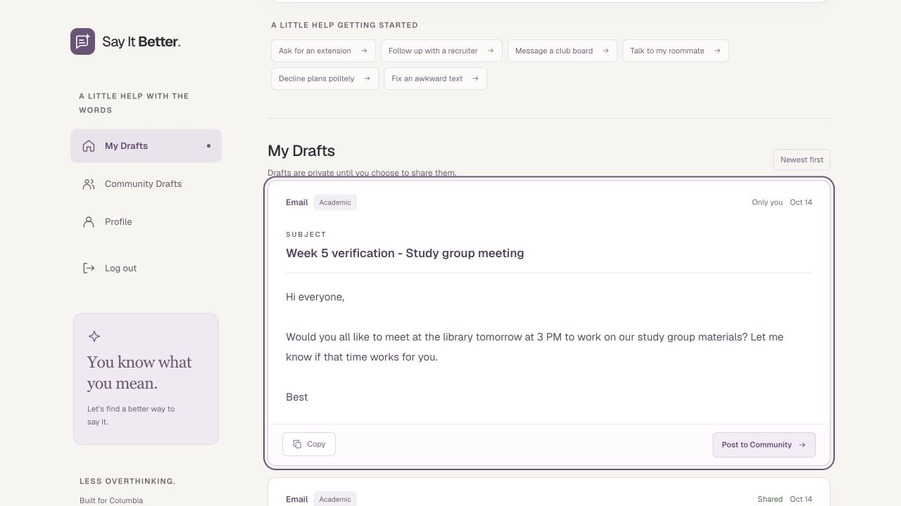

# Week 5 submission readiness — October 14, 2026

Reviewed local commit `7087470a35a79e134d47f0c46bde82c244ec92a3` and the live app. No application-code change, schema/RLS change, push, or deployment was needed for this audit. These observations support readiness; they are not an awarded or guaranteed grade.

Submission URL supplied by the owner: [commit-specific Community page](https://coms-6998-hockcllk8-coms6998.vercel.app/community). Production alias: [Say It Better](https://coms-6998-e.vercel.app). The deployment's Git SHA was not independently checked in the Vercel dashboard.

## Rubric evidence

| Criterion | Points | Evidence and limits |
| --- | ---: | --- |
| End-to-end workflow | 15 | Real Google sign-in, Gemini email generation, private saving, refresh persistence, publishing, Community viewing, voting, unpublishing, and logout passed in the live app. |
| Supabase integration | 10 | Real saved draft and publication changes survived reloads; ratings and aggregate counts reflected mutations. Exact prompt storage and server-derived ownership are covered by code/action tests. Cross-account direct API/RLS isolation was not independently exercised in this audit. |
| Authentication/protection | 10 | Google login succeeded on both domains and returned to the initiating domain. Logout on the submission deployment returned to login; a subsequent protected-page visit still redirected to login. Owner reports a real Barnard account successfully reached the home page. Automated tests reject ineligible and unconfirmed emails. |
| Voting mutations | 10 | All six transitions passed on production with reload after every change: none → positive → none → negative → positive → negative → none. Selected buttons and counts agreed. Adding and removing a vote also passed on the exact submission deployment after reload. |
| Deployment | 5 | Cookie-free HTTP requests to both domains reached the application's login page, with no Vercel login wall. Production About/Privacy and submission About returned 200. The submission URL's authenticated login and voting worked. Dashboard protection settings were not read or changed. |
| Visual design/layout | 25 | Consistent typography, palette, clear draft cards, email subject hierarchy, spacing, category filters and responsive navigation. Live Community and My Drafts measured 390px content width at a 390px viewport; earlier fixture checks also covered desktop and 320px. Final aesthetic judgment belongs to the grader. |
| Usability | 25 | Campus quick starts, private-by-default drafts, explicit sharing confirmation, retained drafts, Copy feedback, rating instructions and immediate selected states support a clear repeat-use flow. Actual PM/group feedback and resulting iteration still need to be described by the owner. |

## Automated/build results

- `node --test tests/week5.test.cjs`: **88 passed**, zero failed.
- `npx tsc --noEmit`: passed.
- `npm run lint`: zero errors; one existing Profile avatar `` optimization warning.
- `npm run build -- --webpack`: passed, including compilation, TypeScript and route generation.
- Default `npm run build` (Turbopack) was blocked by this execution environment: its CSS worker reported `binding to a port / Operation not permitted`. An escalated retry had the same result. This audit does not claim a successful fresh default build. No build configuration was changed to work around the environment.

## Live test details and cleanup

One benign test email was generated on production: **Week 5 verification - Study group meeting**, draft `24`. It survived reload in My Drafts and was absent from Community before publication. Publication made the same draft visible in Community. The six voting transitions each persisted after reload, finishing with both counts zero and neither button selected.

The exact submission deployment then completed Google OAuth without switching to the production alias, displayed the same saved data, and successfully added and removed its vote with refresh checks. Its unpublish control returned the test draft to **Only you**, and Community no longer contained it. Copy displayed success. Native clipboard paste was not independently verified.

The test draft remains in the owner's private My Drafts as evidence. No existing drafts were deleted or edited. No database permissions, RLS, SQL, OAuth configuration, or Vercel settings were changed. The ordinary application workflow created the test draft and performed its publication/vote mutations.

The owner explicitly confirmed that live authenticated DELETE privileges and the own-user, eligible-user, public-caption delete policy exist. This audit verified the resulting vote-removal behavior, rather than changing those policies.

## Before submitting

1. Submit the commit-specific URL above, not just the moving production alias. In Vercel, confirm its source commit is the intended final revision. Use a fresh Incognito window for the final access check.
2. Be ready to show the PM/group feedback: what they found confusing or unhelpful, what you changed, and why it improves repeat use. Do not label features as PM-requested unless that feedback actually occurred. Design and usability account for half the base score.
3. Demonstrate the short flow: choose a campus quick start → generate/save privately → refresh → copy → publish → open Community → rate/switch/undo → refresh → unpublish → logout. Show that both schools can log in, using the reported Barnard test as supporting evidence.
4. Ensure the grader has an eligible Columbia/Barnard account. Public deployment accessibility and intentional application sign-in are separate: the app must be reachable without Vercel protection, while application content remains authenticated as requested.

Optional extra confidence: a second eligible account can verify it cannot see another user's private draft or alter their votes. No bonus points or exact numerical score are assumed.
